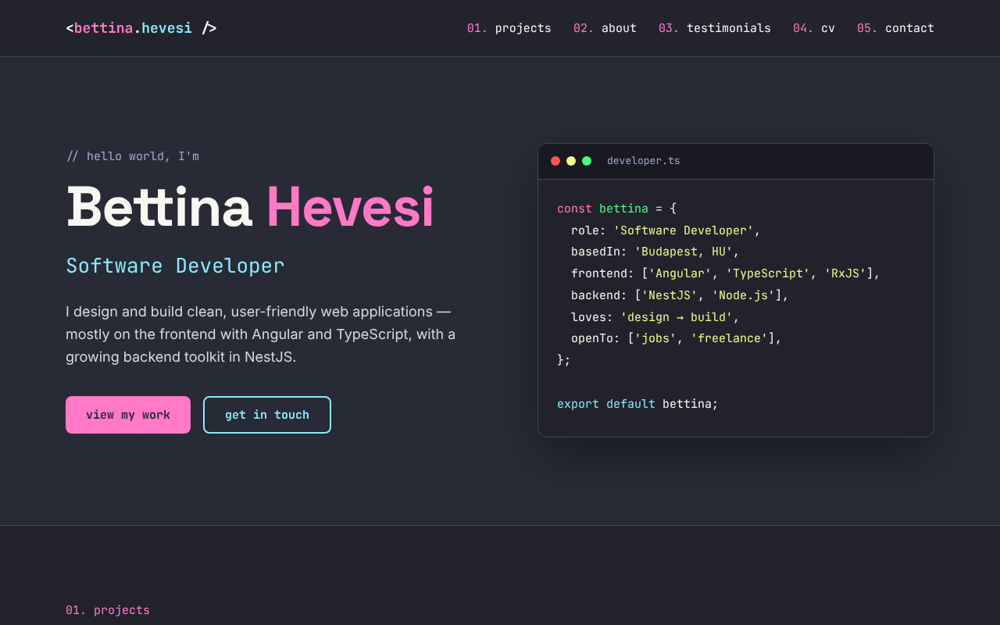
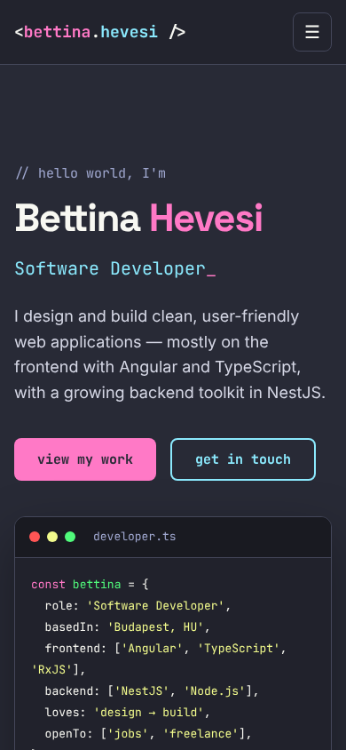

# Bettina Hevesi – Developer Portfolio

My personal portfolio site: **[bettinahevesi.com](https://bettinahevesi.com)**

A single-page, statically prerendered Angular app with a Dracula-inspired, code-editor look.
It presents my projects, skills, CV and a contact form.



## Tech stack

- **Angular 22** – standalone components, signals, new control flow (`@if`, `@for`, `@let`), lazy-loaded page
- **Static site generation** – every route is prerendered at build time (`outputMode: "static"`), no server needed
- **TypeScript** in strict mode, **ESLint** (angular-eslint) and **Prettier**
- **Vitest** unit tests for the important logic (contact form sending, project cards)
- **Formspree** for the contact form (no own backend), with a honeypot spam filter
- Hosted on **Vercel**, deployed automatically from `main`

## Features

- Projects rendered from a JSON data file – adding a project needs no template change
- Design tokens (colours, fonts, spacing) as CSS custom properties in `src/styles.css`
- Accessible: semantic HTML, labelled form fields, visible focus, skip link, keyboard-friendly mobile menu
- `prefers-reduced-motion` respected – the custom cursor and blinking caret switch off
- Responsive from 360 px, SEO meta tags, Open Graph image, `sitemap.xml`, `robots.txt`

## Project structure

```
src/
├── app/
│   ├── components/      # header, hero, projects, project-card, about, resume, contact, footer, custom-cursor
│   ├── data/
│   │   ├── projects.json    # project cards
│   │   └── site-content.ts  # skills, contact links, settings (Formspree endpoint)
│   ├── models/          # TypeScript interfaces
│   ├── pages/home/      # the (lazy-loaded) home page
│   └── services/        # ContactService (Formspree)
├── index.html           # title, meta description, Open Graph tags
└── styles.css           # design tokens and shared styles
public/                  # images, CV, favicon, og-image, robots.txt, sitemap.xml
```

## Running locally

Requires Node.js 22+.

```bash
npm install
npm start          # dev server on http://localhost:4200
npm test           # unit tests
npm run lint       # ESLint
npm run build      # production build → dist/software-dev-portfolio/browser
```

## Updating content

| What | Where |
| --- | --- |
| Add / edit a project | `src/app/data/projects.json` (+ screenshot in `public/img/projects/`) |
| Skills, contact links | `src/app/data/site-content.ts` |
| Contact form endpoint | `SITE.formspreeEndpoint` in `site-content.ts` |
| CV | replace `public/cv/bettina-hevesi-software-dev-cv.pdf` |
| Colours, fonts, spacing | CSS variables in `src/styles.css` |

## Deployment

The repo is connected to Vercel: every push to `main` builds and deploys the site automatically.
Changes are made on a separate branch and merged into `main` via pull request.



## License

Code: MIT. Photos, CV and texts © Bettina Hevesi.
